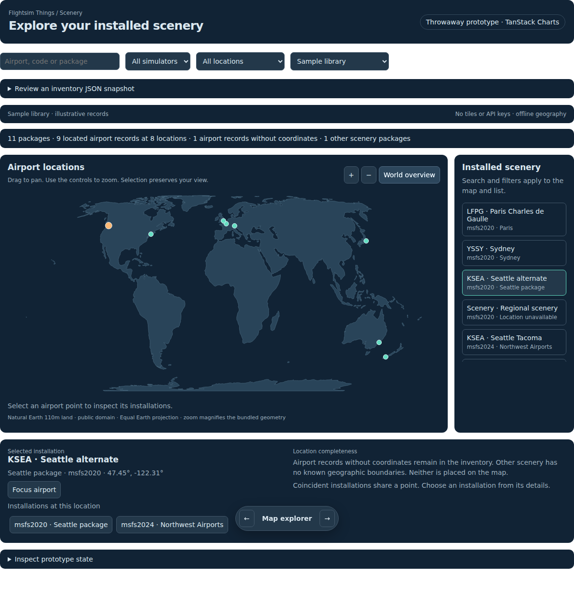

# Scenery map prototype decision

The selected direction is a TanStack Charts geographic overview with a linked scenery inventory. The prototype stays separate from the Electron renderer while the layout and interactions remain under review.

## Existing data flow

Settings scans Community packages. Electron discovers airport observations and persists them in SQLite. Explicit OpenAIP enrichment adds airport metadata and coordinates. Validated preload IPC exposes `SimulatorInventory[]` to React. Enrichment returns a replacement simulator inventory.

The renderer already has enough data for airport points. No new map endpoint or geographic database is needed. Airport identity is the simulator, package folder, and source key. Airport codes are labels. Packages can contain several airports, and several installations can share a location.

Non-airport scenery has no geographic boundaries in the current contract. Keep those packages and airports without coordinates in the inventory. Do not infer coverage polygons or use zero as a placeholder. Nullable coordinates do not identify whether enrichment was attempted.

## Design alternatives

| Design                                                   | Review benefit                                                      | Cost                                                                                                  |
| -------------------------------------------------------- | ------------------------------------------------------------------- | ----------------------------------------------------------------------------------------------------- |
| Standalone TanStack prototype with inventory JSON import | Isolated dependencies and offline review of sample or snapshot data | Requires an existing snapshot for real inventory. The app has no export action.                       |
| Development-only map on the existing scenery route       | Real app inventory and enrichment refresh                           | Changes routing, workspace dependencies, and the development build before the experience is approved. |

Choose the standalone design for this prototype. The independent design review favored its smaller production impact. Keep the import boundary compatible with existing inventory so a later React component can receive the same data directly. Both design candidates and the reviewer used separate contexts on the same model.

The named data shape is an installation record. Each record has a package identity, simulator, display metadata, a kind of airport or scenery package, and a geographic position or null. A single library owns these records. Filters, counts, selection, and coincident point groups derive from it. Import replaces the library only after validation succeeds.

Selection preserves the camera. **Focus airport** moves the camera explicitly. **World overview** resets it. A resize restores the overview in this throwaway implementation.

## Package choice

[TanStack Charts geography](https://tanstack.com/charts/latest/docs/examples/maps-and-spatial) accepts application-owned GeoJSON and uses D3 projections. This supports the current overview without a tile provider. [Apache ECharts](https://echarts.apache.org/en/feature.html) and direct [D3 geography](https://d3js.org/d3-geo) were also prototyped. The current branch retains the chosen TanStack implementation.

[MapLibre](https://maplibre.org/maplibre-gl-js/docs/), [Leaflet](https://leafletjs.com/), and [OpenLayers](https://openlayers.org/) remain alternatives if detailed basemaps become a requirement. Tile, imagery, style, and data licenses are separate from the rendering library license. The bundled Natural Earth geometry is public domain. TanStack Charts is MIT, and the D3 packages are ISC.

## Review and implementation boundary

Run `pnpm prototype:scenery`. The [prototype guide](../../packages/interface/src/prototypes/tanstack-scenery/README.md) describes the layouts, scenarios, and import format.

The prototype tests layout, filtering, selection, coincident installations, and location completeness. It does not implement automatic app inventory access, enrichment, persistence, scenery boundaries, detailed tiles, or zoom-dependent clustering. It makes no measured performance claim.

After review, implement the chosen experience on the existing scenery route with the authoritative app inventory. Verify React lifecycle cleanup, production CSP, scan and enrichment refresh, and packaged desktop behavior before release. This PR is a draft for the throwaway prototype, not that production implementation.

## Verification evidence

The browser run exercised point and list selection, the coincident chooser, focus and reset, search and simulator filters, location filters, empty and missing-coordinate scenarios, and the synthetic density sample. It also exercised valid JSON import, malformed JSON retention, duplicate identity rejection, zero and out-of-range coordinates, drag, both layouts, and a narrow viewport. The run reported no page errors or external requests.

The prototype runner built and served the standalone page. Repository lint, formatting, type checks, and the production interface build passed. These checks do not establish production desktop behavior or a performance result.

